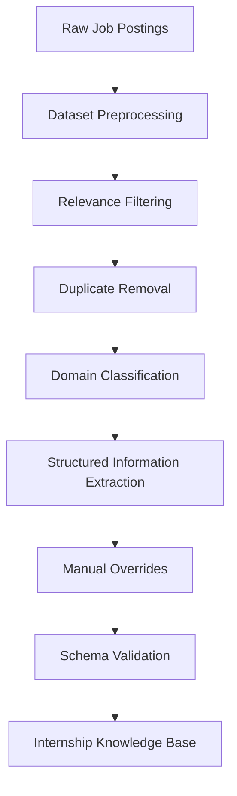
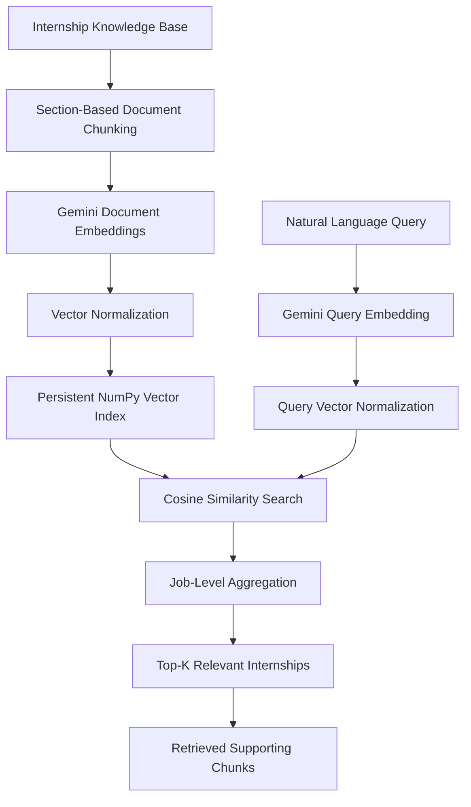

# AI Career Companion Agent

An AI-powered career companion designed to help students with internship applications, resume analysis, skill gap identification, and interview preparation.

## Project Objectives

- Analyze student resumes.
- Match student profiles with internship opportunities.
- Identify missing skills.
- Generate personalized resumes and cover letters.
- Support interview preparation.
- Track internship applications.

## Technology Stack

### Implemented Technologies

- Python
- React
- Vite
- Tailwind CSS
- FastAPI
- SQLite
- Pydantic
- PyMuPDF
- python-docx
- Gemini API integration with rule-based extraction fallback
- Google GenAI SDK
- Gemini Embedding Model (gemini-embedding-001)
- NumPy
- Persistent NumPy-based vector index
- Cosine similarity search

### Technologies Under Research

- PostgreSQL
- ChromaDB / FAISS
- Sentence Transformers
- LangGraph
- OpenAI API

*Technology choices for upcoming milestones will be validated during development.*

## Project Milestones

### Milestone 1 – Research and Foundation

- [x] M1.1 – Research and Technical Understanding
- [x] M1.2 – System Architecture
- [x] M1.3 – Student Profile Module
- [x] M1.4 – Resume Parsing and Extraction

### Milestone 2 – Internship Knowledge Base and Job-Resume Matching

- [x] M2.1 – Internship Dataset and Knowledge Base
- [x] M2.2 – RAG Pipeline and Semantic Search
- [ ] M2.3 – Job-Resume Matching Agent
- [ ] M2.4 – Matching and Retrieval Evaluation

## Implemented Features

### Student Profile and Resume Processing

- Student profile creation and management.
- PDF and DOCX resume upload.
- Resume text extraction and preprocessing.
- Structured candidate information extraction.
- Rule-based extraction fallback.
- Candidate profile and resume data storage.
- Frontend display of extracted resume information.

### Internship Dataset and Knowledge Base

- Standardized job posting schema using Pydantic.
- Dataset preprocessing and relevance filtering.
- Duplicate detection and removal.
- Internship domain classification.
- Responsibilities and qualifications extraction.
- Required and preferred skill extraction.
- Education and experience requirement extraction.
- Manual corrections for extraction failures.
- Structured JSON-based knowledge base.
- Dataset schema validation.

### RAG Pipeline and Semantic Search

- Section-based internship document chunking.
- Overlapping chunks for long document sections.
- Gemini-based document and query embeddings.
- Batch embedding generation.
- Automatic API retry and checkpoint-based recovery.
- Persistent NumPy-based vector indexing.
- Vector normalization and index integrity validation.
- Cosine similarity-based semantic search.
- Job-level aggregation using maximum chunk similarity.
- Top-K retrieval of unique internship postings.
- Retrieval of supporting job description chunks.
- Interactive command-line semantic search.
- Initial natural-language retrieval testing.

## Internship Knowledge Base

The internship knowledge base contains curated historical internship postings from the LinkedIn Job Postings (2023–2024) dataset.

### Dataset Statistics

| Metric | Value |
|---|---:|
| Original dataset records | 123,849 |
| Curated internship postings | 150 |
| Valid records | 150 |
| Invalid or duplicate records detected | 0 |
| Technology domains | 20 |
| Manual overrides | 6 |

### Dataset Processing Pipeline



### Dataset Storage

The final structured knowledge base is stored locally at:

`data/internships.json`

### Dataset Validation

All 150 internship records passed schema validation and duplicate detection checks.

### Dataset Limitations

- The dataset contains historical postings, not verified active vacancies.
- Rule-based extraction may produce incomplete or inaccurate structured information.
- Internship distribution across technology domains is uneven.
- Schema validation does not guarantee semantic extraction accuracy.
- Source and generated datasets are excluded from GitHub pending redistribution permission verification.
- Local dataset files and manual overrides are required to reproduce the complete knowledge base.


## RAG Pipeline and Semantic Search

The internship knowledge base is indexed using an embedding-based
retrieval pipeline to support natural-language internship discovery.

### Vector Index Statistics

| Metric | Value |
|---|---:|
| Internship postings | 150 |
| Generated document chunks | 871 |
| Unique chunk IDs | 871 |
| Average chunks per internship | 5.81 |
| Overview chunks | 399 |
| Responsibility chunks | 151 |
| Skill chunks | 125 |
| Qualification chunks | 196 |
| Embedding model | gemini-embedding-001 |
| Embedding dimensions | 768 |
| Total generated embeddings | 871 |
| Vector data type | float32 |
| Vector storage size | 2.55 MiB |
| Similarity metric | Cosine similarity |

### Document Chunking

Internship postings are divided into meaningful sections:

- Job overview
- Responsibilities
- Required and preferred skills
- Qualifications, education and experience requirements

Long sections are divided using a maximum content length of
250 words with a 30-word overlap.

Each chunk includes contextual metadata such as job title,
company, location, domain and section.

### RAG Retrieval Architecture



### Embedding Generation

The Gemini embedding model generates 768-dimensional vectors
using the RETRIEVAL_DOCUMENT task type for internship chunks.

Embedding generation supports batch processing, automatic
retries and checkpoint-based recovery.

Generated vectors are normalized and stored locally for reuse.

### Vector Index Storage

The retrieval pipeline uses the following local files:

- `data/job_chunks.json`
- `data/job_embeddings.npy`
- `data/job_index_metadata.json`
- `data/embedding_checkpoint.npz`

Index metadata stores the embedding configuration, dataset
signature and ordered chunk identifiers.

Generated artifacts are excluded from version control.

### Index Validation

The generated vector index passed the following checks:

- Expected embedding shape: (871, 768)
- No NaN or infinite values
- No zero-length vectors
- All vectors normalized
- Correct chunk-to-vector mapping
- Valid dataset signature

### Semantic Search

Natural-language queries are embedded using the same Gemini
embedding model with the RETRIEVAL_QUERY task type.

Cosine similarity is calculated using NumPy dot products
between normalized query and document vectors.

Matching chunks are grouped by job ID. Each internship is
ranked using its highest chunk similarity score.

The retriever returns unique internships together with
their original job records and up to three supporting chunks.

### Initial Retrieval Testing

| Test Query Domain | Highest Similarity | Observation |
|---|---:|---|
| AI and Machine Learning | 0.7633 | Five related AI, ML and data science roles retrieved |
| Frontend Development | 0.7473 | Frontend internship ranked first |
| Cybersecurity | 0.7713 | Five cybersecurity roles retrieved |
| Natural-language mobile development | 0.6526 | All four mobile-domain postings retrieved within Top 5 |
| Unrelated culinary arts | 0.6286 | Irrelevant technology roles returned |

The initial tests demonstrate cross-domain semantic retrieval
and natural-language intent recognition.

These results represent preliminary functional testing,
not a comprehensive measurement of retrieval accuracy.

### Running the Retrieval Pipeline

Install the project dependencies:

```bash
pip install -r requirements.txt
```

Configure GEMINI_API_KEY in the local .env file.

Ensure the curated internship knowledge base is available at
`data/internships.json` and its terms permit API processing.

Generate document chunks:

```bash
python -m app.job_chunker
```

Generate and persist document embeddings:

```bash
python -m app.job_embedder
```

Launch the interactive semantic search interface:

```bash
python -m app.job_retriever
```

Existing embeddings can be reused without regenerating the
entire vector index for every search query.

### Implementation Decisions

Gemini embeddings and NumPy-based exact vector search were
selected after local PyTorch and FAISS libraries encountered
Windows application control restrictions.

For the current dataset size, exact vector search provides
a lightweight alternative to a dedicated vector database.

### Retrieval Limitations

- Semantic similarity does not represent student-job compatibility.
- Top-K retrieval can return irrelevant jobs for out-of-domain queries.
- Maximum chunk similarity may favor jobs containing more chunks.
- Uneven domain distribution can affect retrieval results.
- Rule-based extraction inaccuracies may affect indexed content.
- Gemini API availability and rate limits affect embedding generation.
- Query embedding requires an external API connection.
- A reliable relevance threshold has not yet been established.
- Historical postings are not verified active internship vacancies.
- Comprehensive retrieval and matching evaluation is planned for M2.4.
- Dataset redistribution and third-party processing permissions require verification.

Student-specific compatibility scoring, skill gap analysis and
matching explanations will be implemented in M2.3.


## Documentation

Research and technical documentation are available in the `docs/` directory.

## Project Status

## Project Status

- Milestone 1 – Completed.
- M2.1 – Internship Dataset and Knowledge Base completed.
- M2.2 – RAG Pipeline and Semantic Search completed.
- M2.3 – Job-Resume Matching Agent is the next development phase.
- M2.4 – Matching and Retrieval Evaluation is pending.

The project is under active development.
