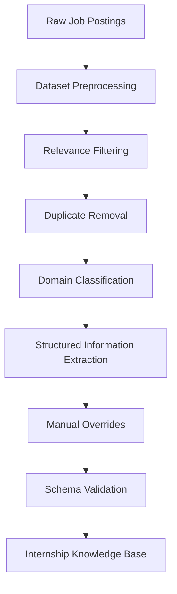

# AI Career Companion Agent

An AI-powered career companion designed to help students with internship applications, resume analysis, skill gap identification, and interview preparation.

## Project Objectives

- Analyze student resumes.
- Match student profiles with internship opportunities.
- Identify missing skills.
- Generate personalized resumes and cover letters.
- Support interview preparation.
- Track internship applications.

## Technology Stack

### Implemented Technologies

- Python
- React
- Vite
- Tailwind CSS
- FastAPI
- SQLite
- Pydantic
- PyMuPDF
- python-docx
- Gemini API integration with rule-based extraction fallback

### Technologies Under Research

- PostgreSQL
- ChromaDB / FAISS
- Sentence Transformers
- LangGraph
- OpenAI API

*Technology choices for upcoming milestones will be validated during development.*

## Project Milestones

### Milestone 1 – Research and Foundation

- [x] M1.1 – Research and Technical Understanding
- [x] M1.2 – System Architecture
- [x] M1.3 – Student Profile Module
- [x] M1.4 – Resume Parsing and Extraction

### Milestone 2 – Internship Knowledge Base and Job-Resume Matching

- [x] M2.1 – Internship Dataset and Knowledge Base
- [ ] M2.2 – RAG Pipeline and Semantic Search
- [ ] M2.3 – Job-Resume Matching Agent
- [ ] M2.4 – Matching and Retrieval Evaluation

## Implemented Features

### Student Profile and Resume Processing

- Student profile creation and management.
- PDF and DOCX resume upload.
- Resume text extraction and preprocessing.
- Structured candidate information extraction.
- Rule-based extraction fallback.
- Candidate profile and resume data storage.
- Frontend display of extracted resume information.

### Internship Dataset and Knowledge Base

- Standardized job posting schema using Pydantic.
- Dataset preprocessing and relevance filtering.
- Duplicate detection and removal.
- Internship domain classification.
- Responsibilities and qualifications extraction.
- Required and preferred skill extraction.
- Education and experience requirement extraction.
- Manual corrections for extraction failures.
- Structured JSON-based knowledge base.
- Dataset schema validation.

## Internship Knowledge Base

The internship knowledge base contains curated historical internship postings from the LinkedIn Job Postings (2023–2024) dataset.

### Dataset Statistics

| Metric | Value |
|---|---:|
| Original dataset records | 123,849 |
| Curated internship postings | 150 |
| Valid records | 150 |
| Invalid or duplicate records detected | 0 |
| Technology domains | 20 |
| Manual overrides | 6 |

### Dataset Processing Pipeline

### Dataset Storage

The final structured knowledge base is stored locally at:

`data/internships.json`

### Dataset Validation

All 150 internship records passed schema validation and duplicate detection checks.

### Dataset Limitations

- The dataset contains historical postings, not verified active vacancies.
- Rule-based extraction may produce incomplete or inaccurate structured information.
- Internship distribution across technology domains is uneven.
- Schema validation does not guarantee semantic extraction accuracy.
- Source and generated datasets are excluded from GitHub pending redistribution permission verification.
- Local dataset files and manual overrides are required to reproduce the complete knowledge base.

## Documentation

Research and technical documentation are available in the `docs/` directory.

## Project Status

- Milestone 1 – Completed.
- M2.1 – Internship Dataset and Knowledge Base completed.
- M2.2 – RAG Pipeline and Semantic Search is the next development phase.

The project is under active development.
