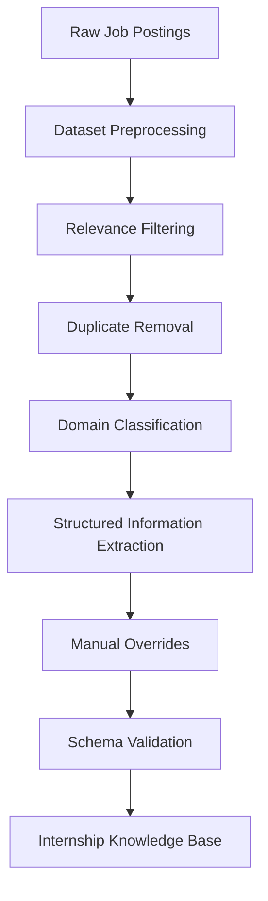
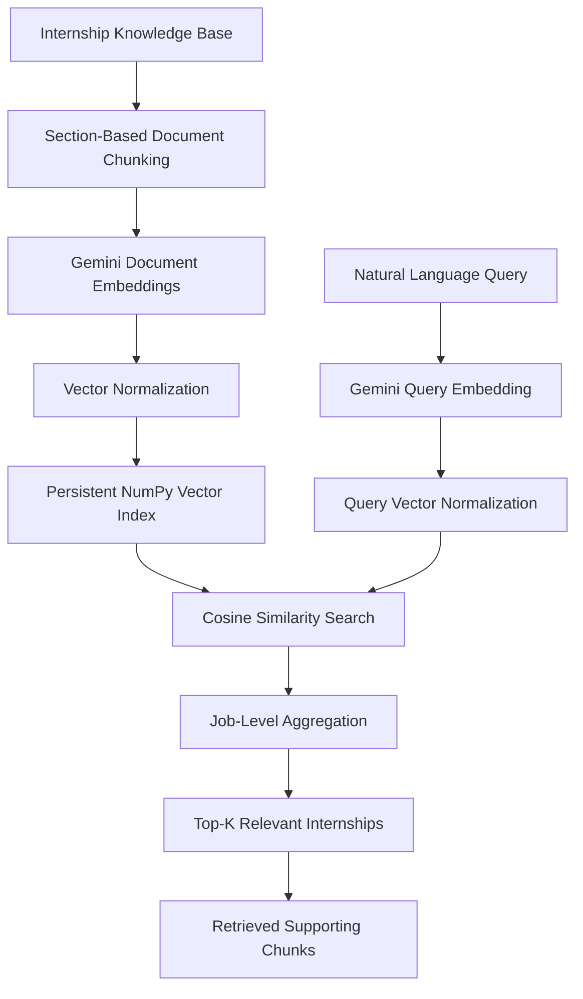
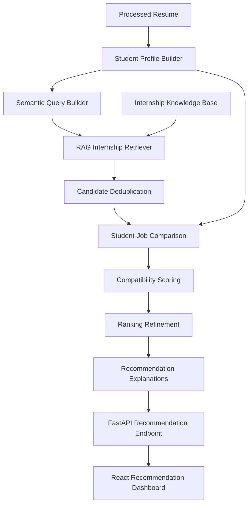

# AI Career Companion Agent

An AI-powered career companion designed to help students with internship applications, resume analysis, skill gap identification, and interview preparation.

## Project Objectives

- Analyze student resumes.
- Match student profiles with internship opportunities.
- Identify missing skills.
- Generate personalized resumes and cover letters.
- Support interview preparation.
- Track internship applications.

## Technology Stack

### Implemented Technologies

- Python
- React
- Vite
- Tailwind CSS
- FastAPI
- SQLite
- Pydantic
- PyMuPDF
- python-docx
- Gemini API integration with rule-based extraction fallback
- Google GenAI SDK
- Gemini Embedding Model (gemini-embedding-001)
- NumPy
- Persistent NumPy-based vector index
- Cosine similarity search

### Technologies Under Research

- PostgreSQL
- ChromaDB / FAISS
- Sentence Transformers
- LangGraph
- OpenAI API

*Technology choices for upcoming milestones will be validated during development.*

## Project Milestones

### Milestone 1 – Research and Foundation

- [x] M1.1 – Research and Technical Understanding
- [x] M1.2 – System Architecture
- [x] M1.3 – Student Profile Module
- [x] M1.4 – Resume Parsing and Extraction

### Milestone 2 – Internship Knowledge Base and Job-Resume Matching

- [x] M2.1 – Internship Dataset and Knowledge Base
- [x] M2.2 – RAG Pipeline and Semantic Search
- [x] M2.3 – Job-Resume Matching Agent
- [x] M2.4 - Matching and Retrieval Evaluation

## Implemented Features

### Student Profile and Resume Processing

- Student profile creation and management.
- PDF and DOCX resume upload.
- Resume text extraction and preprocessing.
- Structured candidate information extraction.
- Rule-based extraction fallback.
- Candidate profile and resume data storage.
- Frontend display of extracted resume information.

### Internship Dataset and Knowledge Base

- Standardized job posting schema using Pydantic.
- Dataset preprocessing and relevance filtering.
- Duplicate detection and removal.
- Internship domain classification.
- Responsibilities and qualifications extraction.
- Required and preferred skill extraction.
- Education and experience requirement extraction.
- Manual corrections for extraction failures.
- Structured JSON-based knowledge base.
- Dataset schema validation.

### RAG Pipeline and Semantic Search

- Section-based internship document chunking.
- Overlapping chunks for long document sections.
- Gemini-based document and query embeddings.
- Batch embedding generation.
- Automatic API retry and checkpoint-based recovery.
- Persistent NumPy-based vector indexing.
- Vector normalization and index integrity validation.
- Cosine similarity-based semantic search.
- Job-level aggregation using maximum chunk similarity.
- Top-K retrieval of unique internship postings.
- Retrieval of supporting job description chunks.
- Interactive command-line semantic search.
- Initial natural-language retrieval testing.

## Internship Knowledge Base

The internship knowledge base contains curated historical internship postings from the LinkedIn Job Postings (2023–2024) dataset.

### Dataset Statistics

| Metric | Value |
|---|---:|
| Original dataset records | 123,849 |
| Curated internship postings | 150 |
| Valid records | 150 |
| Invalid or duplicate records detected | 0 |
| Technology domains | 20 |
| Manual overrides | 6 |

### Dataset Processing Pipeline



### Dataset Storage

The final structured knowledge base is stored locally at:

`data/internships.json`

### Dataset Validation

All 150 internship records passed schema validation and duplicate detection checks.

### Dataset Limitations

- The dataset contains historical postings, not verified active vacancies.
- Rule-based extraction may produce incomplete or inaccurate structured information.
- Internship distribution across technology domains is uneven.
- Schema validation does not guarantee semantic extraction accuracy.
- Source and generated datasets are excluded from GitHub pending redistribution permission verification.
- Local dataset files and manual overrides are required to reproduce the complete knowledge base.


## RAG Pipeline and Semantic Search

The internship knowledge base is indexed using an embedding-based
retrieval pipeline to support natural-language internship discovery.

### Vector Index Statistics

| Metric | Value |
|---|---:|
| Internship postings | 150 |
| Generated document chunks | 871 |
| Unique chunk IDs | 871 |
| Average chunks per internship | 5.81 |
| Overview chunks | 399 |
| Responsibility chunks | 151 |
| Skill chunks | 125 |
| Qualification chunks | 196 |
| Embedding model | gemini-embedding-001 |
| Embedding dimensions | 768 |
| Total generated embeddings | 871 |
| Vector data type | float32 |
| Vector storage size | 2.55 MiB |
| Similarity metric | Cosine similarity |

### Document Chunking

Internship postings are divided into meaningful sections:

- Job overview
- Responsibilities
- Required and preferred skills
- Qualifications, education and experience requirements

Long sections are divided using a maximum content length of
250 words with a 30-word overlap.

Each chunk includes contextual metadata such as job title,
company, location, domain and section.

### RAG Retrieval Architecture



### Embedding Generation

The Gemini embedding model generates 768-dimensional vectors
using the RETRIEVAL_DOCUMENT task type for internship chunks.

Embedding generation supports batch processing, automatic
retries and checkpoint-based recovery.

Generated vectors are normalized and stored locally for reuse.

### Vector Index Storage

The retrieval pipeline uses the following local files:

- `data/job_chunks.json`
- `data/job_embeddings.npy`
- `data/job_index_metadata.json`
- `data/embedding_checkpoint.npz`

Index metadata stores the embedding configuration, dataset
signature and ordered chunk identifiers.

Generated artifacts are excluded from version control.

### Index Validation

The generated vector index passed the following checks:

- Expected embedding shape: (871, 768)
- No NaN or infinite values
- No zero-length vectors
- All vectors normalized
- Correct chunk-to-vector mapping
- Valid dataset signature

### Semantic Search

Natural-language queries are embedded using the same Gemini
embedding model with the RETRIEVAL_QUERY task type.

Cosine similarity is calculated using NumPy dot products
between normalized query and document vectors.

Matching chunks are grouped by job ID. Each internship is
ranked using its highest chunk similarity score.

The retriever returns unique internships together with
their original job records and up to three supporting chunks.

### Initial Retrieval Testing

| Test Query Domain | Highest Similarity | Observation |
|---|---:|---|
| AI and Machine Learning | 0.7633 | Five related AI, ML and data science roles retrieved |
| Frontend Development | 0.7473 | Frontend internship ranked first |
| Cybersecurity | 0.7713 | Five cybersecurity roles retrieved |
| Natural-language mobile development | 0.6526 | All four mobile-domain postings retrieved within Top 5 |
| Unrelated culinary arts | 0.6286 | Irrelevant technology roles returned |

The initial tests demonstrate cross-domain semantic retrieval
and natural-language intent recognition.

These results represent preliminary functional testing,
not a comprehensive measurement of retrieval accuracy.

### Running the Retrieval Pipeline

Install the project dependencies:

```bash
pip install -r requirements.txt
```

Configure GEMINI_API_KEY in the local .env file.

Ensure the curated internship knowledge base is available at
`data/internships.json` and its terms permit API processing.

Generate document chunks:

```bash
python -m app.job_chunker
```

Generate and persist document embeddings:

```bash
python -m app.job_embedder
```

Launch the interactive semantic search interface:

```bash
python -m app.job_retriever
```

Existing embeddings can be reused without regenerating the
entire vector index for every search query.

### Implementation Decisions

Gemini embeddings and NumPy-based exact vector search were
selected after local PyTorch and FAISS libraries encountered
Windows application control restrictions.

For the current dataset size, exact vector search provides
a lightweight alternative to a dedicated vector database.

### Retrieval Limitations

- Semantic similarity does not represent student-job compatibility.
- Top-K retrieval can return irrelevant jobs for out-of-domain queries.
- Maximum chunk similarity may favor jobs containing more chunks.
- Uneven domain distribution can affect retrieval results.
- Rule-based extraction inaccuracies may affect indexed content.
- Gemini API availability and rate limits affect embedding generation.
- Query embedding requires an external API connection.
- A reliable relevance threshold has not yet been established.
- Historical postings are not verified active internship vacancies.
- Retrieval and matching evaluation was completed in M2.4 using partially annotated evaluation data.
- Dataset redistribution and third-party processing permissions require verification.

## Job-Resume Matching Agent (M2.3)

The Job-Resume Matching Agent combines resume-based semantic retrieval, structured requirement comparison, compatibility scoring and evidence-based recommendation explanations.

The agent uses the internship knowledge base and RAG pipeline implemented in M2.1 and M2.2 to generate personalized internship recommendations.

### Implemented Features

- Structured student profile construction from processed resumes.
- Skill normalization and evidence tracking.
- Resume-based semantic query generation.
- Multi-query internship retrieval and candidate deduplication.
- Required and preferred skill comparison.
- Alternative skill requirement handling.
- Education and experience requirement comparison.
- Project-based practical activity matching.
- Weighted compatibility scoring.
- Evidence coverage calculation.
- Technical requirement availability adjustments.
- Eligibility requirement verification flags.
- Ranked internship recommendations.
- Matching strengths and skill gap explanations.
- Personalized improvement priorities.
- FastAPI recommendation endpoint.
- React-based recommendation interface.

### Matching Agent Architecture



### Matching Agent Components

| Module | Responsibility |
|---|---|
| student_profile_builder.py | Constructs normalized student profiles |
| job_query_builder.py | Generates resume-based semantic queries |
| job_candidate_retriever.py | Retrieves and deduplicates internship candidates |
| job_requirement_parser.py | Identifies alternative skill requirements |
| job_resume_matcher.py | Compares required and preferred skills |
| job_education_matcher.py | Evaluates education alignment |
| job_experience_matcher.py | Evaluates experience alignment |
| job_project_matcher.py | Compares practical project activities |
| student_job_comparator.py | Combines structured comparison results |
| job_compatibility_scorer.py | Calculates compatibility and evidence coverage |
| job_matching_refinement.py | Refines ranking and detects eligibility constraints |
| job_ranking_engine.py | Coordinates candidate ranking |
| job_recommendation_explainer.py | Generates explanations and improvement priorities |

### Resume-Based Retrieval

The student profile is used to generate up to four semantic query categories:

- Technical skills.
- Projects.
- Professional experience.
- Education.

Queries are embedded using Gemini and compared against the persistent NumPy vector index.

The recommendation endpoint retrieves up to 15 internships per query and considers up to 40 unique candidates before structured ranking.

Duplicate internships are removed using their job identifiers.

### Compatibility Scoring

The matching agent uses a weighted scoring approach.

| Matching Component | Weight |
|---|---:|
| Required skills | 40% |
| Preferred skills | 10% |
| Education | 15% |
| Experience | 15% |
| Projects | 10% |
| Semantic similarity | 10% |
| **Total** | **100%** |

Each evaluated component contributes a normalized matching ratio.

Requirements that are not specified are excluded from applicable scoring weights. Unresolved requirements reduce evidence coverage instead of being treated as confirmed matches.

The scoring formulas are:

```text
Earned Weight = Sum of evaluated weighted matching ratios

Compatibility Score = (Earned Weight / Evaluated Weight) × 100

Evidence Coverage = Evaluated Weight / Applicable Weight

Base Ranking Score = Compatibility Score × Evidence Coverage

Final Ranking Score = Base Ranking Score × Technical Evidence Factor
```

Scores may remain unavailable when insufficient evidence exists.

### Technical Evidence Refinement

The ranking engine applies technical evidence factors using
resolved job requirements and student matching evidence.

| Technical Alignment | Ranking Factor |
|---|---:|
| At least one required technical requirement matched | 1.00 |
| No required technical requirements matched | 0.50 |
| Preferred-only technical requirements with a match | 0.75 |
| Preferred-only technical requirements without a match | 0.50 |
| Insufficient technical requirement information | 0.50 |

Alternative skill groups are counted as individual requirements
rather than treating every alternative as mandatory.

The technical factor is a heuristic ranking adjustment.
Detailed required and preferred technical match ratios are
reported separately.

Confirmed mandatory eligibility mismatches are ranked after
candidates without confirmed mandatory mismatches, regardless
of their numerical ranking scores.

Compatibility and ranking scores are matching indicators,
not probabilities of internship selection.

### Eligibility Verification

The matching agent identifies unresolved eligibility conditions, including:

- Education and degree requirements.
- Academic year and academic performance requirements.
- Experience requirements.
- Integrated degree program eligibility.
- Citizenship requirements.
- Security clearance mentions.
- Work authorization and sponsorship requirements.

Unresolved conditions are presented as verification warnings rather than confirmed eligibility decisions.

### Recommendation Explanations

Each recommendation includes:

- Internship information.
- Compatibility and ranking scores.
- Evidence coverage.
- Matched skills.
- Required and preferred skill gaps.
- Matching strengths.
- Project and education evidence.
- Improvement priorities.
- Eligibility verification details.
- Evidence limitations.

Missing resume evidence does not necessarily mean that the student lacks a particular skill.

### Recommendation API

**Endpoint:** `POST /recommendations/generate`

Example request:

```json
{
  "candidate_id": "existing-candidate-id",
  "resume_id": "processed-resume-id",
  "top_k": 10
}
```

The recommendation count defaults to 10 and accepts integers from 1 to 20.

The resume must belong to the specified candidate and have completed processing.

The response contains:

- candidate_id
- resume_id
- ranking_statistics
- retrieval_statistics
- queries
- recommendations

#### API Response Status Codes

| Status | Description |
|---|---|
| 200 | Recommendations generated successfully |
| 403 | Resume does not belong to the specified candidate |
| 404 | Candidate or resume not found |
| 409 | Resume processing or extraction is incomplete |
| 422 | Invalid request or insufficient profile information |
| 503 | Recommendation service unavailable |

Interactive API documentation is available at `http://127.0.0.1:8000/docs` when the backend is running.

### Frontend Integration

The React dashboard provides a dedicated Recommendations page containing:

- Configurable recommendation count.
- Recommendation generation controls.
- Loading and error states.
- Ranked internship cards.
- Compatibility and ranking score indicators.
- Evidence coverage information.
- Matched skill indicators.
- Expandable recommendation explanations.
- Skill gaps and improvement priorities.
- Eligibility warnings.
- Historical dataset disclaimer.

Existing student profile retrieval and updating are supported through GET and PUT requests, avoiding unnecessary duplicate profile creation.

### Running the Recommendation System

Ensure the Python dependencies, Gemini API configuration, internship knowledge base and generated vector index are available.

Start the backend from the project root:

```bash
python -m uvicorn app.main:app --reload
```

Start the frontend in a separate terminal:

```bash
cd frontend
npm install
npm run dev
```

Open the frontend URL displayed by Vite.

Create or load a student profile, upload and process a resume, and navigate to Recommendations to generate internship matches.

### Functional Validation

| Validation | Result |
|---|---|
| Dataset-wide comparison validation | 150/150 records processed |
| Controlled recommendation explanation tests | 20/20 passed |
| Refined end-to-end pipeline checks | 13/13 passed |
| Live recommendation explanation checks | 13/13 passed |
| API registration and request schema checks | 10/10 passed |
| Live recommendation API checks | 20/20 passed |
| Advanced controlled API error-path checks | 8/8 passed |
| Backend compilation | Passed |
| Python dependency validation | Passed |
| Full frontend ESLint | Passed |
| Frontend production build | Passed |
| Git whitespace validation | Passed |

A live API test using a processed resume retrieved 20 unique internship candidates, ranked all 20 and returned the requested 10 recommendations in approximately 6.14 seconds.

Desktop browser testing confirmed recommendation rendering, score visualization, expandable explanations, skill gaps and eligibility warnings.

Mobile testing confirmed the initial recommendation layout, sidebar navigation and student profile retrieval and updating.

These results represent functional implementation checks. They do not establish measured recommendation accuracy.

### Current Limitations

- Recommendations use historical internship postings rather than verified active vacancies.
- Structured requirement extraction may contain incomplete or inaccurate information.
- Skill matching depends on the available vocabulary and resume evidence.
- Recognized alternative requirements are supported, but unfamiliar expressions may remain unresolved.
- Education and experience requirements may remain unresolved.
- Project matching relies on recognized activity patterns.
- Compatibility weights and ranking adjustments are heuristic.
- Recommendation explanations are template-based.
- Unresolved eligibility warnings require manual verification. Confirmed mandatory degree mismatches are ranked below candidates without confirmed mismatches.
- Gemini API availability and rate limits affect semantic retrieval.
- Recommendation results are not persistently stored in the frontend.
- Authentication and secure account management are not implemented.
- Desktop and mobile recommendation smoke tests have passed. Broader device and error-state coverage remains future work.
- Dataset redistribution and third-party processing permissions require verification.

Retrieval quality assessment, matching evaluation, ranking analysis and targeted refinement were completed in M2.4.


## Matching and Retrieval Evaluation (M2.4)

M2.4 evaluates the internship recommendation pipeline through
synthetic student profiles, partially annotated suitability
judgments, regression testing and live end-to-end execution.

### Evaluation Objectives

- Evaluate semantic retrieval relevance.
- Measure Top-K recommendation quality.
- Assess required and preferred skill matching.
- Validate compatibility score consistency.
- Compare rankings against expected suitability judgments.
- Validate recommendation explanations and eligibility warnings.
- Identify ranking limitations and implement targeted refinements.
- Verify backend, frontend and browser integration.

### Evaluation Profiles

| Profile | Career Focus |
|---|---|
| P01 | Artificial Intelligence and Machine Learning |
| P02 | Frontend Development |
| P03 | Data Analytics |
| P04 | Software Engineering |
| P05 | Cybersecurity |
| P06 | UI/UX Design |
| P07 | Beginner Technical Profile |
| P08 | Non-technical negative control |
| P09 | Empty-profile negative control |

Seven profiles support semantic retrieval. Two negative controls
verify rejection of insufficient career-related information.

The evaluation uses a historical dataset of 150 internships
and a fixed reference year of 2026.

### Ground Truth and Evaluation Methodology

The evaluation annotations contain:

- 36 suitability judgments.
- 33 relevance judgments across searchable profiles.
- 25 known relevant profile-job pairs.
- 17 known suitable profile-job pairs.
- 8 known highly suitable profile-job pairs.

Judgments were prepared from selected internship records and
synthetic student profiles without using recommendation scores.

The annotations are assistant-generated, partially complete
and not independently human-verified.

Unjudged internships are not automatically classified as
irrelevant or unsuitable. Reported recall refers to known
annotated pairs rather than exhaustive dataset-wide recall.

### Retrieval Configuration Evaluation

Five retrieval depths were evaluated using cached semantic
retrieval results and the production ranking pipeline.

| Retrieval Depth | Candidate Instances | Top-5 Known Suitable | Top-10 Known Suitable | Top-20 Known Suitable |
|---:|---:|---:|---:|---:|
| 10 | 116 | 5 | 10 | 14 |
| 15 | 166 | 6 | 11 | 17 |
| 20 | 216 | 6 | 10 | 15 |
| 30 | 277 | 5 | 10 | 15 |
| 40 | 280 | 5 | 9 | 13 |

A retrieval depth of 15 was selected because it achieved
the strongest Top-10 and Top-20 known suitability results
while limiting the candidate pool size.

The production configuration uses:

- 15 internships per semantic query.
- A maximum of 40 unique candidates per student profile.
- A default API response size of 10 recommendations.
- A configurable API response size between 1 and 20.

The offline experiment evaluated 1,055 candidate instances
across all five retrieval configurations.

### Matching and Ranking Refinements

The evaluation resulted in the following improvements:

- Context-aware alternative skill requirement resolution.
- Recognition of certifications intended for future acquisition.
- Strict mandatory degree requirement detection.
- Evidence-based technical ranking adjustments.
- Required and preferred technical alignment reporting.
- Mandatory eligibility mismatch ordering.
- Additional work authorization and citizenship review detection.
- Eligibility detection within extracted responsibilities.
- Expanded recommendation explanations.
- Frontend visualization of technical alignment and requirement
  interpretation.

### Matching-Only Ranking Evaluation

| Metric | Original | Refined |
|---|---:|---:|
| Comparable suitability pairs | 52 | 52 |
| Correctly ordered pairs | 38 | 46 |
| Incorrectly ordered pairs | 14 | 6 |
| Pairwise ranking accuracy | 73.08% | 88.46% |

Pairwise ranking accuracy improved by 15.38 percentage points.

These are in-sample results on partially annotated evaluation
data, not independently validated generalization accuracy.

### Live End-to-End Evaluation

The final evaluation executed the production recommendation
engine using live Gemini query embeddings and the existing
vector index.

| Metric | Result |
|---|---:|
| Searchable profiles evaluated | 7 |
| Negative controls passed | 2 |
| Logical semantic queries | 20 |
| Candidate instances | 166 |
| Known relevant pairs retrieved | 19/25 |
| Known relevant retrieval recall | 76.00% |
| Known suitable pairs retrieved | 17/17 |
| Known suitable retrieval recall | 100.00% |
| Known highly suitable pairs retrieved | 8/8 |
| Correct conditional suitability pairs | 15/19 |
| Conditional pairwise ranking accuracy | 78.95% |
| Eligibility ordering violations | 0 |
| Live and cached ranking consistency | 7/7 profiles |
| Mean live profile execution time | 2.51 seconds |

Execution time excludes initial recommendation engine
construction. Logical query counts exclude API retries.

### Top-K Recommendation Quality

| Metric | Top 5 | Top 10 | Top 20 |
|---|---:|---:|---:|
| Known relevant pairs | 6 | 11 | 18 |
| Known suitable pairs | 6 | 11 | 17 |
| Known highly suitable pairs | 4 | 7 | 8 |
| Known suitable recall | 35.29% | 64.71% | 100.00% |

The internal evaluation supports cutoffs up to 40 candidates.
The public API limits returned recommendations to 20.

Although all known suitable internships were recovered within
Top 20, early ranking quality remains an improvement opportunity.

At retrieval depth 15, structured reranking reduced known
suitable Top-5 results from 10 to 6 compared with semantic-only
ordering. Top-20 known suitable results increased from 16 to 17.

This trade-off is retained as an evaluation finding rather than
claiming improvement at every ranking cutoff.

### Regression and Integration Testing

| Validation | Result |
|---|---|
| Cumulative targeted checks | 414/414 passed |
| Permanent regression checks | 168/168 passed |
| Dataset-wide eligibility validation | 150/150 processed |
| Offline live-evaluation preflight | 64/64 passed |
| Backend compilation and dependency checks | Passed |
| Frontend ESLint | Passed |
| Frontend production build | Passed |
| Live browser recommendation API | HTTP 200 |
| Browser internships evaluated | 25 |
| Browser recommendations returned | 10/10 |
| Browser API response time | 7.71 seconds |
| Desktop recommendation rendering | Passed |
| Expanded recommendation details | Passed |
| Mobile recommendation smoke test | Passed at 390 x 642 |
| Browser console | No visible runtime errors |

Targeted checks represent implementation validation,
not recommendation accuracy percentages.

Two non-blocking browser autofill warnings were observed.
Three hidden console messages were not independently inspected.

### Evaluation Reproducibility

Evaluation scripts are maintained in the `evaluation/` directory.

The evaluation workflow includes synthetic profile generation,
ground truth preparation, retrieval metric validation, retrieval
depth comparison, matching-only evaluation, offline evaluation,
component diagnostics, regression testing and live evaluation.

Core evaluation commands:

```bash
python -m evaluation.create_sample_profiles
python -m evaluation.test_skill_requirement_resolver
python -m evaluation.test_technical_alignment
python -m evaluation.test_recommendation_explanations
python -m evaluation.evaluate_retrieval
python -m evaluation.evaluate_retrieval_depth
python -m evaluation.evaluate_end_to_end_offline
python -m evaluation.evaluate_end_to_end_live
```

Dataset-dependent evaluations require the local internship
knowledge base, compatible vector index, evaluation annotations
and prerequisite evaluation artifacts.

Live evaluations require a valid Gemini API configuration
and may consume API quota.

Generated reports, checkpoints, raw internship descriptions
and dataset-derived artifacts are retained locally pending
redistribution permission verification.

A fresh repository clone alone is therefore insufficient
to reproduce the complete historical evaluation.

### Evaluation Limitations

- Ground truth annotations are partial and not human-verified.
- The evaluation uses seven searchable synthetic profiles.
- Matching-only and live pairwise metrics evaluate different
  candidate pairs and are not directly comparable.
- Ranking refinements were evaluated using development annotations.
- Early Top-K recommendation quality requires further improvement.
- Specialized technical vocabulary remains incomplete.
- Job section extraction may miss or misclassify requirements.
- Compatibility weights and technical factors are heuristic.
- Missing resume evidence does not prove absence of a skill.
- Unresolved eligibility requires manual verification.
- Historical internships are not verified active vacancies.
- API latency and availability depend on external services.
- Dataset redistribution permissions require verification.

M2.4 completes the planned technical evaluation and refinement
phase while retaining these limitations for future development.


## Documentation

Research and technical documentation are available in the `docs/` directory.


## Project Status

- Milestone 1 – Completed.
- M2.1 – Internship Dataset and Knowledge Base completed.
- M2.2 – RAG Pipeline and Semantic Search completed.
- M2.3 – Job-Resume Matching Agent completed.
- M2.4 - Matching and Retrieval Evaluation completed.

The project is under active development.
