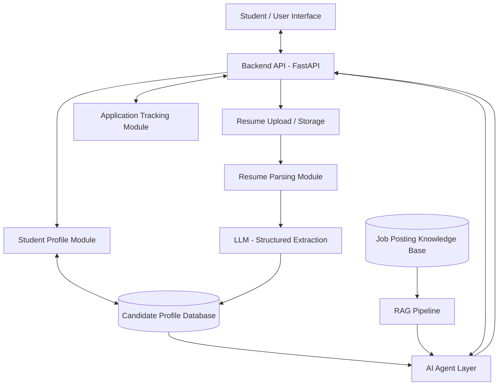

# M1.2 – System Architecture

## 1. Introduction


The AI Career Companion is an AI-powered internship
application assistance system designed to help students
prepare for and manage internship opportunities.

The system uses Large Language Models (LLMs),
Retrieval-Augmented Generation (RAG), and a multi-agent
architecture to provide personalized career assistance.

The platform aims to simplify the internship application
process by offering the following functionalities:

- Student profile creation and management.
- Resume uploading and automated information extraction.
- AI-powered job and resume matching.
- Skill gap identification and recommendations.
- Resume analysis and improvement suggestions.
- Personalized cover letter generation.
- AI-assisted interview preparation.
- Career guidance and internship application tracking.

The system follows a modular architecture consisting of
a user interface, backend API, database, resume processing
module, RAG pipeline, and specialized AI agents.

Milestone 1 focuses on establishing the system foundation,
designing the architecture, implementing student profile
management, and extracting structured candidate information
from uploaded resumes.

The remaining AI agent capabilities and advanced RAG
functionalities will be implemented progressively in
future milestones.


## 2. Overall System Architecture


The AI Career Companion follows a modular architecture
that separates the user interface, backend services,
data storage, resume processing, and AI components.

The backend API acts as the central communication layer
between the user interface and the system services.

The resume processing module extracts candidate
information from uploaded resumes using document
parsing techniques and LLM-based structured extraction.

The candidate profile database stores student details,
skills, education, experience, and project information.

The RAG pipeline retrieves relevant information from
the job-posting knowledge base to support AI-generated
recommendations.

The multi-agent layer consists of six specialized agents
that collaborate to provide internship and career
assistance.

### System Architecture Diagram




## 3. Architecture Components


### 3.1 Student / User Interface

The Student/User Interface allows students to interact
with the AI Career Companion platform.

Responsibilities:
- Create and manage student profiles.
- Upload resumes.
- View extracted resume information.
- Access AI-powered career assistance.
- View internship recommendations.
- Track internship applications.

Technology: HTML, CSS, JavaScript.

### 3.2 Backend / API Layer

The backend handles communication between the frontend,
database, resume processing modules, and AI services.

Responsibilities:
- Process frontend requests.
- Validate student profile information.
- Handle resume uploads.
- Communicate with the database.
- Invoke resume parsing and LLM services.
- Coordinate AI agent requests.

Technology: Python, FastAPI.

### 3.3 Database

The database stores student information and
structured candidate profiles.

Stored information includes:
- Student identification and contact details.
- Education and qualifications.
- Technical and soft skills.
- Work experience and internships.
- Academic and personal projects.
- Resume metadata and storage references.
- Extracted resume information.

Technology: SQLite for Milestone 1.

### 3.4 Resume Upload and Storage

This component manages uploaded resume documents.

Responsibilities:
- Accept PDF and DOCX resume files.
- Validate file types and file sizes.
- Store resumes securely.
- Generate unique stored filenames.
- Maintain resume metadata.
- Associate resumes with student profiles.

Technology: FastAPI UploadFile and file storage.

### 3.5 Resume Parsing Module

The resume parsing module converts uploaded resume
documents into machine-readable text.

Responsibilities:
- Extract text from PDF resumes.
- Extract text from DOCX resumes.
- Normalize extracted text.
- Prepare text for LLM processing.
- Handle unsupported or unreadable documents.

Technology: PyMuPDF and python-docx.

### 3.6 Large Language Model (LLM)

The LLM processes resume text and extracts structured
candidate information.

Extracted information includes:
- Candidate name and contact details.
- Technical and soft skills.
- Education and qualifications.
- Work experience.
- Internships.
- Projects and technologies.
- Certifications and achievements.

The extracted information is validated and stored
in the candidate profile database.

Technology: Gemini API.

### 3.7 Candidate Profile Module

The candidate profile module manages structured
student information.

Responsibilities:
- Create student profiles.
- Update profile information.
- Store extracted resume details.
- Associate resumes with candidates.
- Retrieve profiles for AI-based analysis.

### 3.8 Job-Posting Knowledge Base

The job-posting knowledge base stores internship
opportunities and their requirements.

Information may include:
- Job title and company.
- Required technical skills.
- Qualifications and eligibility.
- Job descriptions.
- Internship location and duration.

This component will support job-resume matching
and skill gap analysis in future milestones.

### 3.9 Retrieval-Augmented Generation (RAG) Pipeline

The RAG pipeline retrieves relevant job information
to improve the contextual accuracy of AI responses.

Planned workflow:
1. Collect internship job descriptions.
2. Convert job descriptions into embeddings.
3. Store embeddings in a vector database.
4. Retrieve relevant job information.
5. Supply retrieved context to the LLM.
6. Generate context-aware recommendations.

Planned Technology: ChromaDB and an embedding model.

### 3.10 AI Agent Layer

The AI Agent Layer contains six specialized agents:

1. Career Assistant Agent.
2. Job-Resume Matching Agent.
3. Skill Gap Agent.
4. Resume Agent.
5. Cover Letter Agent.
6. Interview Agent.

Each agent performs a specific task.

The Career Assistant acts as the main coordinator
and routes student requests to appropriate agents.

The agents use structured candidate profiles,
retrieved job information, and LLM capabilities
to generate personalized assistance.

Detailed responsibilities are defined in Section 4.

### 3.11 Application Tracking Module

The Application Tracking Module manages the status
of internship applications.

Responsibilities:
- Record internship applications.
- Track application progress.
- Maintain application status.
- Store important application dates.
- Display application history.

Possible statuses include:
- Saved
- Applied
- Interview Scheduled
- Offered
- Rejected

This module is planned for future milestones.

### 3.12 Communication and Data Flow

The system uses API-based communication between
the frontend and backend.

Resume processing follows this sequence:

1. A student creates a profile.
2. The student uploads a resume.
3. The backend validates and stores the file.
4. The resume parsing module extracts raw text.
5. The extracted text is sent to the LLM.
6. The LLM returns structured candidate information.
7. The backend validates the extracted data.
8. The structured information is stored in the database.
9. The student reviews the extracted profile.

In future milestones, the AI agents will use
candidate profiles and RAG-retrieved job information
to provide personalized internship assistance.


## 4. AI Agent Responsibilities

### 4.1 Career Assistant Agent
Role: Central coordinator of the AI Career Companion system.

Responsibilities:
- Understand student requests.
- Coordinate the specialist agents.
- Collect and combine agent responses.
- Provide personalized career guidance.

### 4.2 Job-Resume Matching Agent
Role: Match student profiles with internship opportunities.

Responsibilities:
- Analyze candidate skills and qualifications.
- Analyze internship requirements.
- Calculate compatibility between candidates and jobs.
- Recommend suitable internships.

### 4.3 Skill Gap Agent
Role: Identify missing skills required for target internships.

Responsibilities:
- Compare candidate skills with job requirements.
- Identify missing technical and soft skills.
- Recommend learning resources.
- Suggest skill improvement paths.

### 4.4 Resume Agent
Role: Analyze and improve student resumes.

Responsibilities:
- Analyze resume structure and content.
- Identify missing information.
- Suggest improvements.
- Optimize resume content for internship applications.

### 4.5 Cover Letter Agent
Role: Generate personalized cover letters.

Responsibilities:
- Understand internship requirements.
- Use candidate profile information.
- Generate customized cover letters.
- Maintain professional formatting and language.

### 4.6 Interview Agent
Role: Help students prepare for internship interviews.

Responsibilities:
- Generate role-specific interview questions.
- Provide technical and HR questions.
- Suggest answers based on candidate experience.
- Provide interview preparation guidance.

## 5. Agent Input, Processing and Output Design

Each AI agent receives specific input data, performs its assigned task, and generates structured output. The Career Assistant coordinates the specialist agents and presents their results to the student.

### 5.1 Career Assistant Agent

**Input:**
- Student queries
- Candidate profile
- Results from specialist agents

**Processing:**
- Understands the student's request.
- Identifies which specialist agent is required.
- Coordinates agent execution.
- Combines the results.

**Output:**
- Personalized career guidance
- Combined agent responses
- Recommended next actions

### 5.2 Job-Resume Matching Agent

**Input:**
- Candidate skills
- Education details
- Experience and projects
- Internship descriptions
- Required qualifications

**Processing:**
- Compares candidate qualifications with internship requirements.
- Identifies matching skills.
- Evaluates candidate-job compatibility.

**Output:**
- Recommended internships
- Match score
- Matching skills
- Missing requirements

### 5.3 Skill Gap Agent

**Input:**
- Candidate skills
- Target internship requirements
- Job descriptions

**Processing:**
- Compares existing skills with required skills.
- Identifies missing or insufficient skills.
- Recommends learning priorities.

**Output:**
- Identified skill gaps
- Recommended skills to learn
- Suggested learning roadmap

### 5.4 Resume Agent

**Input:**
- Uploaded resume
- Structured candidate profile
- Target internship description

**Processing:**
- Analyzes resume content.
- Checks clarity and structure.
- Identifies missing or weak information.
- Suggests improvements relevant to the target role.

**Output:**
- Resume analysis
- Improvement suggestions
- Optimized resume content

### 5.5 Cover Letter Agent

**Input:**
- Candidate profile
- Resume information
- Internship description
- Company information, when available

**Processing:**
- Identifies relevant candidate qualifications.
- Understands internship requirements.
- Generates personalized cover letter content.

**Output:**
- Customized cover letter
- Editable cover letter content

### 5.6 Interview Agent

**Input:**
- Candidate profile
- Target internship role
- Required skills
- Relevant job description

**Processing:**
- Identifies relevant interview topics.
- Generates technical and HR questions.
- Provides suggested answers and preparation guidance.

**Output:**
- Interview questions
- Suggested answers
- Preparation recommendations

### 5.7 Agent Communication

The Career Assistant acts as the central coordinator. It delegates tasks to specialist agents, receives their outputs, and combines relevant results.

Agent outputs should use structured formats so that information can be passed reliably between components. The exact communication implementation will be finalized during development.

## 6. Candidate / Student Profile Data Model

### 6.1 Overview

The Candidate Profile Data Model defines how student information is organized and stored in the AI Career Companion system.

The system maintains structured candidate information that can be used by the AI agents for internship matching, skill gap analysis, resume improvement, cover letter generation, and interview preparation.

PostgreSQL is proposed as the primary relational database.

### 6.2 Candidate Profile

The Candidate table stores the basic information of each registered student.

| Field | Data Type | Description |
|---|---|---|
| candidate_id | UUID | Unique candidate identifier |
| full_name | VARCHAR | Student's full name |
| email | VARCHAR | Email address |
| phone | VARCHAR | Contact number |
| location | VARCHAR | Current location |
| professional_summary | TEXT | Short professional introduction |
| created_at | TIMESTAMP | Profile creation date |
| updated_at | TIMESTAMP | Last profile update |

### 6.3 Education Details

The Education table stores the academic background of a candidate.

| Field | Data Type | Description |
|---|---|---|
| education_id | UUID | Unique education identifier |
| candidate_id | UUID | Reference to candidate |
| degree | VARCHAR | Degree or qualification |
| institution | VARCHAR | College or university |
| field_of_study | VARCHAR | Subject or specialization |
| start_year | INTEGER | Starting year |
| graduation_year | INTEGER | Completion year |
| grade | VARCHAR | CGPA or percentage |

### 6.4 Skills

The Skills table stores technical and soft skills identified from the resume or entered by the student.

| Field | Data Type | Description |
|---|---|---|
| skill_id | UUID | Unique skill identifier |
| candidate_id | UUID | Reference to candidate |
| skill_name | VARCHAR | Name of the skill |
| category | VARCHAR | Technical or soft skill |
| proficiency | VARCHAR | Beginner, Intermediate or Advanced |

### 6.5 Experience Details

The Experience table stores the candidate's work and internship experience.

| Field | Data Type | Description |
|---|---|---|
| experience_id | UUID | Unique experience identifier |
| candidate_id | UUID | Reference to candidate |
| company_name | VARCHAR | Organization name |
| job_title | VARCHAR | Position held |
| start_date | DATE | Starting date |
| end_date | DATE | Ending date |
| description | TEXT | Responsibilities and achievements |

### 6.6 Projects

The Projects table stores academic and personal projects completed by the student.

| Field | Data Type | Description |
|---|---|---|
| project_id | UUID | Unique project identifier |
| candidate_id | UUID | Reference to candidate |
| project_title | VARCHAR | Project name |
| description | TEXT | Project details |
| technologies | TEXT | Tools and technologies used |
| project_url | VARCHAR | Project or GitHub link |

### 6.7 Certifications

The Certifications table stores professional courses and certificates completed by the candidate.

| Field | Data Type | Description |
|---|---|---|
| certification_id | UUID | Unique certification identifier |
| candidate_id | UUID | Reference to candidate |
| certificate_name | VARCHAR | Certificate title |
| issuing_organization | VARCHAR | Issuing institution |
| issue_date | DATE | Date issued |
| credential_url | VARCHAR | Certificate verification link |

### 6.8 Resume Metadata

The Resume table stores information about uploaded resumes. The actual resume files are stored separately in file storage.

| Field | Data Type | Description |
|---|---|---|
| resume_id | UUID | Unique resume identifier |
| candidate_id | UUID | Reference to candidate |
| file_name | VARCHAR | Uploaded file name |
| file_path | TEXT | Storage location |
| file_type | VARCHAR | PDF or DOCX |
| upload_date | TIMESTAMP | Upload date |
| parsing_status | VARCHAR | Pending, Processing, Completed or Failed |

### 6.9 Relationships Between Tables

- One candidate can have multiple education records.
- One candidate can have multiple skills.
- One candidate can have multiple experience records.
- One candidate can have multiple projects.
- One candidate can have multiple certifications.
- One candidate can upload multiple resumes.

The candidate_id field acts as a foreign key in the related tables and connects their information to the main Candidate table.

### 6.10 Usage by AI Agents

The structured candidate profile provides information to the AI agents.

- Job-Resume Matching Agent: Uses education, skills, projects and experience.
- Skill Gap Agent: Compares existing skills with internship requirements.
- Resume Agent: Uses candidate information to analyze and improve resumes.
- Cover Letter Agent: Uses candidate details and internship information.
- Interview Agent: Uses skills, projects and experience to generate interview questions.
- Career Assistant: Coordinates access to relevant candidate information and specialist agents.

### 6.11 Data Storage Considerations

PostgreSQL is proposed for structured candidate information. Uploaded resumes will be stored in a separate file storage system, while the database maintains their metadata.

Appropriate access controls and data protection measures will be implemented to protect student information.

## 7. Resume Upload, Parsing and Structured Profile Data Flow

### 7.1 Overview

The resume processing workflow converts an uploaded student resume into structured candidate information.

The system accepts PDF and DOCX resume files, extracts their text, identifies relevant candidate information using an LLM, validates the extracted information, and stores it in the candidate profile.

### 7.2 Resume Upload

The student uploads a resume through the frontend interface.

The backend receives the file through the FastAPI API layer.

The system initially supports:
- PDF documents
- DOCX documents

The uploaded file is checked for:
- Supported file format
- File size restrictions
- Valid file content

After validation, the file is stored in the resume storage system. Its metadata is recorded in the database.

### 7.3 Resume Parsing

The Resume Parsing Module extracts readable text from the uploaded document.

Proposed technologies:

- PyMuPDF: Extracts text from PDF documents.
- python-docx: Extracts text from DOCX documents.

The extracted text is passed to the information extraction component.

Scanned PDF documents may require an OCR component because they may contain images instead of selectable text.

### 7.4 LLM-Based Information Extraction

The extracted resume text is processed using a Large Language Model.

The LLM identifies and organizes information into predefined categories.

Information to be extracted includes:

1. Personal details
2. Education
3. Technical skills
4. Soft skills
5. Work experience
6. Internship experience
7. Projects
8. Certifications

The extraction component is designed to produce structured JSON output.

### 7.5 Structured Output Generation

The extracted information is organized into a predefined candidate profile schema.

Example:

```json
{
  "full_name": "Rahul",
  "email": "rahul@example.com",
  "education": [
    {
      "degree": "B.Sc Computer Science",
      "institution": "ABC College"
    }
  ],
  "skills": [
    "Python",
    "SQL",
    "Machine Learning"
  ],
  "projects": [
    {
      "title": "Student Performance Prediction",
      "technologies": [
        "Python",
        "Machine Learning"
      ]
    }
  ],
  "experience": [],
  "certifications": []
}
```

This is an illustrative example of the expected output format. The actual extraction depends on the information available in the uploaded resume.

### 7.6 Data Validation

Before saving the extracted information, the system validates the generated output.

Validation includes:
- Checking required field formats.
- Checking data types.
- Handling missing information.
- Validating email and date formats where applicable.
- Ensuring that unsupported information is not treated as confirmed candidate data.

The student should be able to review and correct extracted information before it is finalized in the profile.

### 7.7 Candidate Profile Storage

After validation and student review, the structured information is stored in PostgreSQL.

The information is distributed across the related candidate profile tables:

- Candidate
- Education
- Skills
- Experience
- Projects
- Certifications
- Resume Metadata

The original resume is maintained separately in file storage.

### 7.8 Resume Processing Status

The system maintains processing statuses for uploaded resumes.

| Status | Description |
|---|---|
| Pending | Resume uploaded and waiting for processing |
| Processing | Resume is being parsed and analyzed |
| Completed | Extraction and profile update completed |
| Failed | Resume processing encountered an error |

### 7.9 Usage of Extracted Information

The structured candidate profile becomes the information source for the AI agent layer.

- Job-Resume Matching Agent uses candidate qualifications and skills.
- Skill Gap Agent compares candidate skills with internship requirements.
- Resume Agent analyzes candidate resume content.
- Cover Letter Agent uses candidate information to generate personalized letters.
- Interview Agent uses candidate skills, projects and experience.
- Career Assistant coordinates these agents and provides personalized guidance.

### 7.10 Conclusion

The resume processing workflow converts unstructured resume documents into structured candidate information.

This process establishes the foundation for student profile creation, resume analysis, internship matching and personalized AI career assistance.


### 7.11 Resume Processing Data Flow Diagram
